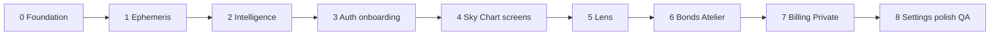

# Grahalens — Build Plan

> Read this first. Product understanding, locked architecture, full screen
> inventory reference (`docs/SCREENS.md`), payments, and the phase map
> `PROMPTS.md` follows. Specs: `docs/PRD.md`, `docs/BRAND-BOOK.md`,
> `docs/SCREENS.md`.

---

## 1. What we are building (product understanding)

**Grahalens** (Sanskrit *graha* = planet + *lens*) is a **mobile-only,
production-grade** spiritual intelligence companion. The agent is **Lens**.

This build is an **end-to-end app**: every screen in `docs/SCREENS.md` ships
with real navigation, state, entitlements, and payment logic — Nummi-class
companion depth + Co-Star-class daily/social chart energy, in Observatory craft.

```
Welcome → birth onboarding → compute chart
        ↓
Soft paywall (skippable once) → Sky home
        ↓
Five tabs fully wired (Sky · Chart · Lens · Bonds · Atelier)
        ↓
Feature gates → Paywall (RevenueCat / mock) → Private unlock
        ↓
Settings: subscription manage, restore, legal, delete
```

### Competitive DNA (inspire — do not pixel-clone)

| Source | Take | Leave |
|---|---|---|
| **Nummi AI** | Vedic + AI memory companion, past-life, journal, daily cosmic guidance, Pro subscription shape | Thin chrome, generic chat shell |
| **Co-Star** | Daily sky object, friends/compatibility, premium gating, screenshot-ready cards | Snark, pure B&W meme look, Western-only |
| **The Pattern** | Psychological timing language, relationship domains | Flat feed, no dialogue |

### Standout features (keep)

Living Chart · Sky Weather · Dasha Ribbon · Bond Constellation · Companion
Memory · Soul Cartography · Muhurta Moments · Reflection Atelier — plus
**production Private subscription** with real purchase state machine.

### Information architecture

**Five tabs** + full nested stacks per `docs/SCREENS.md` (~45 production
routes). Auth/onboarding/paywall/settings are first-class, not stubs.

| Tab | Home route | Nested highlights |
|---|---|---|
| Sky | `/(app)/sky` | weather, muhurta, day archive, inbox |
| Chart | `/(app)/chart` | planet, dasha, transits, aspects, cosmic profile |
| Lens | `/(app)/lens` | threads, starters, memories, quota gate |
| Bonds | `/(app)/bonds` | add wizard, constellation, domains, share |
| Atelier | `/(app)/atelier` | journal CRUD, soul, patterns, check-in |

### Computation before narration (sacred)

| Step | Module | LLM? |
|---|---|---|
| 1 | Birth resolve | No |
| 2 | `compute-natal.ts` (Lahiri whole-sign) | No |
| 3 | `compute-dasha.ts` | No |
| 4 | `compute-transits.ts` | No |
| 5 | `sky-weather.ts` / `muhurta-moments.ts` | No |
| 6 | narrate + ground | Groq + check |
| 7 | soul cartography | Groq + heuristics |
| 8 | companion + memory | Groq + retrieve |
| 9 | bond synastry | No + optional narrate |

### Entitlements (locked)

| Tier | Gets |
|---|---|
| **Free** | Sky, Chart core, 5 Lens msgs/day, 1 Bond, journal, soul **preview** |
| **Private** (`grahalens_private`) | Unlimited Lens, unlimited Bonds, full Soul, Pattern Thread, day archive unlimited, export |

Products: `grahalens_private_monthly` ($7.99), `grahalens_private_yearly`
($49.99, 3-day trial). See SCREENS §8.

---

## 2. Locked architecture decisions

| Decision | Choice | Rationale |
|---|---|---|
| Framework | Expo SDK 54 + Expo Router + TypeScript strict | Mobile + Cursor |
| UI | Hand-built Observatory — **no** UI kits | Brand craft |
| Styling | `theme/tokens.ts` + StyleSheet | RN-native |
| Navigation | Expo Router; every SCREENS route exists | E2E completeness |
| DB + Auth | Supabase + guest SQLite | Sync + local |
| LLM | Groq + deterministic fallbacks | Honest offline |
| Ephemeris | astronomy-engine + Lahiri | Pure JS |
| Houses | Whole-sign Lahiri | Vedic-first |
| Chart UI | Skia Living Chart | 60fps |
| State | Zustand + TanStack Query | Clear split |
| **IAP** | **RevenueCat** (`react-native-purchases`) + `EXPO_PUBLIC_IAP_MODE=mock\|store` | Production purchases; mock for Cursor/dev without store |
| Entitlements | Single entitlement `grahalens_private`; gate helper `lib/billing/entitlements.ts` | One source of truth |
| Tests | Jest + Maestro full smoke incl. mock purchase | SCREENS §11 |
| Canvas | 390×844 primary | Both platforms |

### State ownership (Zustand vs TanStack Query)

The split above is only a decision until it says who owns what. Every prompt
uses this table — do not invent a per-screen convention.

| Lives in | What | Examples |
|---|---|---|
| **Zustand** | Client truth that outlives a screen but never comes from a server round-trip | theme (Ink/Dawn), entitlement snapshot from `useEntitlement()`, onboarding draft before confirm, Lens orb state, session/guest identity |
| **TanStack Query** | Anything read from Supabase or Groq, keyed and cacheable | journal entries, bonds, threads + memories, day archive, narrations, usage counters, RevenueCat offerings |
| **Component state** | Transient interaction only | scrubber position, sheet open, text input buffer |
| **Nothing (derived)** | Ephemeris output — recompute from birth data, never persist as state | natal chart, dasha periods, transits, sky weather, muhurta windows |

Rules: ephemeris results are memoized per birth-data hash, never mirrored into
Zustand. Entitlement is read through the billing helpers (§2 row) and cached in
Zustand only as a snapshot — RevenueCat remains the source of truth. Every
Expo Router route in `docs/SCREENS.md` reads state through these four lanes.

### Still out of scope (this build)

- Live astrologer marketplace / dating discovery feed
- Western Placidus toggle (schema-ready later)
- Voice mode / Soul Song audio
- Wear OS / widgets
- Pixel-perfect clones of Nummi/Co-Star assets (original Observatory UI only)

### In scope now (was previously post-beta)

- Full screen map end-to-end
- RevenueCat IAP + restore + manage subscription screens
- Soft + hard paywalls with real unlock logic
- Free quotas enforced in code

---

## 3. Repository layout (target)

```
grahalens-final-app/
  app/
    (auth)/           splash, welcome, sign-in, sign-up, guest
    onboarding/       date, time, place, confirm, computing
    (app)/            sky|chart|lens|bonds|atelier (+ nested stacks)
    paywall/          index, sheet, success, unavailable
    settings/         hub + all X* screens
    dev/              system, screens index
  components/
    brand/            Wordmark, LensOrb, ObservatoryGrain, ObservatoryTabBar
    icons/            Icon.tsx + tabs/ graha/ system/ domains/ weather/
    ui/ chart/ sky/ lens/ bonds/ atelier/
    billing/          PaywallPlans, PriceCard, RestoreButton, LockGlyph, QuotaChip
  lib/
    ephemeris/ sky/ ai/ memory/ bonds/ format/ supabase/
    billing/          offerings, purchase, restore, entitlements, mockStore
  theme/ fixtures/ tests/ maestro/
  supabase/migrations/
  docs/               PRD, BRAND-BOOK, SCREENS, SETUP
```

---

## 4. Phase map



| Phase | Prompts | Delivers |
|---|---|---|
| 0 Foundation | 01–03 | Expo, Observatory system, **full icon pack + ObservatoryTabBar**, Supabase + subscriptions |
| 1 Ephemeris | 04–06 | Natal, dasha, transits + tests |
| 2 Intelligence | 07–09 | Weather, muhurta, narrate/ground, soul heuristics |
| 3 Auth + onboarding | 10–12 | Full A* screens + computing + soft paywall entry |
| 4 Sky + Chart | 13–16 | All S* and C* screens + Living Chart + Dasha |
| 5 Lens | 17–19 | All L* + quota enforcement |
| 6 Bonds + Atelier | 20–22 | All B* and R* with gates |
| 7 Billing | 23–25 | RevenueCat + mock, P* screens, entitlement wiring |
| 8 Settings + ship | 26–30 | All X*, brand audit, Maestro e2e, TESTING pass |

Rules:

1. Computation before chrome (phases 1–2 before pixel polish).
2. No fake astrology; no dead “coming soon” screens on the map.
3. Grounding zero-tolerance.
4. Brand book wins visuals.
5. Every GATE/SOFT uses shared billing helpers — never ad-hoc booleans.
6. Verify before advancing.

---

## 5. Definition of done

- Every route in `docs/SCREENS.md` reachable from `/dev/screens` or nav.
- Free vs Private behavior matches entitlement legend.
- Mock IAP: purchase → unlock → restore → settings status.
- Store mode documented in SETUP for real TestFlight/Play.
- `npm run test:beta` + `TESTING.md` green including payment section.
- Brand §15 on all primary tabs + paywall + onboarding.
